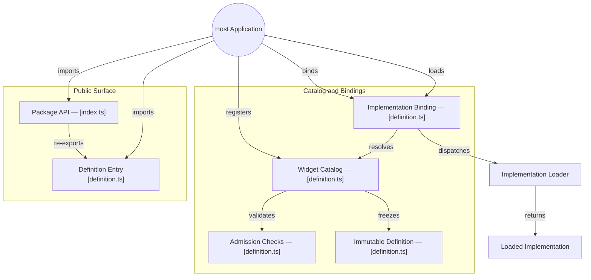

# GitDiagram architecture — @konitif/widgets

This architecture view was generated from the public repository by [GitDiagram](https://gitdiagram.com/lemouf/konitif-widgets) on 2026-09-20 19:01:48 UTC.

It is a documentation projection of the repository tree, README, and source files sampled by GitDiagram. It does not replace the authored contracts in [catalog.json](catalog.json) and [diagrams.json](diagrams.json), nor does it establish runtime authority.

The Mermaid source keeps GitDiagram's groups, nodes, relationships, and source links. GitDiagram's forced color classes and HTML line breaks are omitted so the diagram remains readable in local previews and dark themes.

- Public repository: [konitif-widgets](https://github.com/LeMouf/konitif-widgets)
- Interactive diagram: [Open in GitDiagram](https://gitdiagram.com/lemouf/konitif-widgets)

## Architecture diagram

## Generated analysis

@konitif/widgets is a small host-independent runtime library for admitting widget definitions and associating them with explicit lazy implementation loaders. A host imports the public API, registers a definition, binds a loader to its identifier, then invokes the binding to obtain an implementation. The catalog validates and freezes definitions; mounting, caching, lifecycle, persistence, and application state remain outside this package. The graph reflects sampled source and documented authority boundaries.
